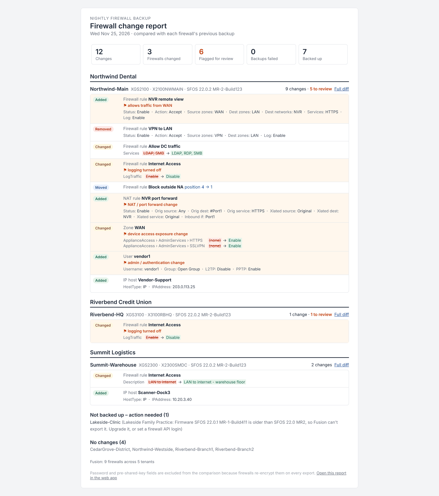
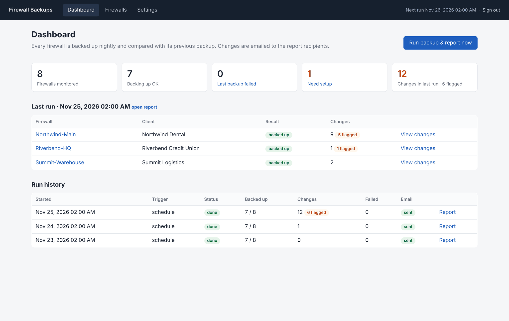
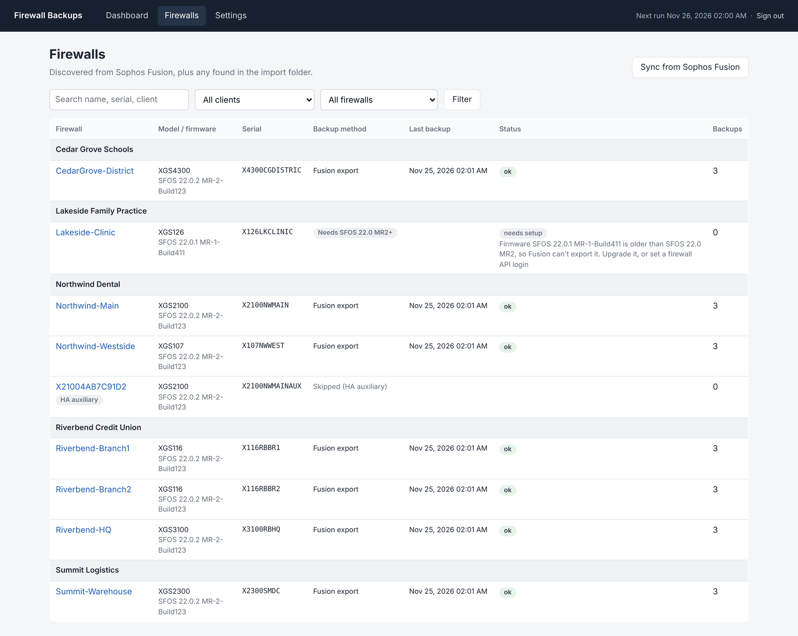
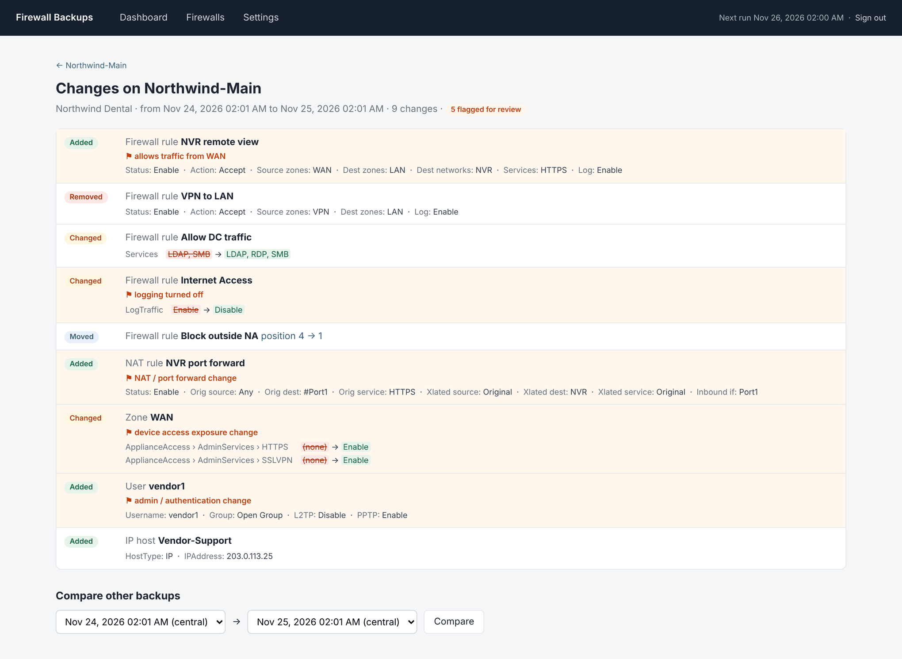

# Firewall Backups and Change Reports – MSP nightly Sophos backups and change reports for Sophos Fusion

A self-hosted web app for **MSPs and IT teams managing Sophos Firewalls through Sophos Central / Sophos Fusion**. Every night it:

1. Finds every client firewall through your **Sophos Fusion (Central) partner API** credential.
2. Takes a full configuration backup of each firewall.
3. Compares it with that firewall's previous backup.
4. Emails a report that highlights every change: rules **added**, **removed**, **changed** (field by field, old → new) and **moved**, for firewall rules, NAT rules, zones, hosts, users, VPN, web/IPS/app policies, routes and more. Risky changes, such as new WAN access, port forwards, logging turned off or admin changes, are flagged for review.

You can also browse firewalls, download any backup, and compare any two backups in the web UI. It runs in Docker and needs nothing installed on the firewalls.





*Screenshots use made-up demo clients.*

### Features

- Backups through the Sophos Fusion configuration export (SFOS 22.0 MR2+), with the firewall XML API or a folder of `.tar` exports as fallbacks
- Field-by-field change reports grouped by client, emailed through SMTP or Microsoft 365 (Graph)
- Rule moves detected; password and pre-shared-key fields re-encrypted on every export are ignored
- HA pairs handled: the auxiliary unit is skipped, since the primary's backup covers the cluster
- Ignore noisy fields or whole configuration types (such as auto-created IPv6 router advertisements) in Settings
- Backup retention, per-firewall history and side-by-side comparison of any two backups

## Where the backups come from

**Sophos Fusion configuration export (main method).** Central Firewall Management can export a firewall's full configuration through the API, for firewalls on **SFOS 22.0 MR2 or later**. Each night the app asks Fusion to export every connected firewall, waits for the export to finish, then downloads the `.tar` and reads its `Entities.xml`. Nothing needs to be set up on the firewalls, the app never connects to them, and no admin console has to be reachable.

Fusion can export a firewall when all of these are true:
- it runs SFOS 22.0 MR2 or later
- it's connected to and managed from Sophos Fusion
- it has an active paid subscription (other than the Base License) or an active support contract

**Firewall XML API (optional fallback).** For firewalls Fusion can't export, mainly older firmware, the app can read the configuration directly from the firewall's own API. This is only used where you've set a firewall API login, either per firewall or as a default in Settings. The Firewalls page shows which method each firewall will use.

**Import folder (optional).** Point the app at a folder of `.tar` exports and it imports each new one as a backup, matched to its firewall by serial number or name. `summary.csv` is used when present.

### Using the firewall API fallback

Only needed for firewalls Fusion can't export:

1. **Backup & firmware › API**: turn on *API configuration* and allow the app server's IP.
2. Create a read-only administrator for the app, and enter its login on the firewall's page or as the default in Settings.
3. Make sure the server can reach the firewall on port 4444, ideally over a site-to-site VPN. Set the firewall's **Address** in the app to its LAN or tunnel IP. **Don't open the admin console on WAN for this.**

Upgrading those firewalls to SFOS 22.0 MR2 or later removes the need for the fallback.

## Install from git (Docker)

On the Docker host:

```bash
git clone <repo-url> fwbackup && cd fwbackup
cp .env.example .env && chmod 600 .env
nano .env                     # ADMIN_PASSWORD, APP_SECRET_KEY (openssl rand -hex 32), APP_BASE_URL, SOPHOS_*, email
docker compose up -d --build
```

To update later: `cd fwbackup && git pull && docker compose up -d --build`. Your `.env` and `data/` folder are never touched by git.

For a private repo, give the server read access with a deploy key (repo › Settings › Deploy keys) or clone over HTTPS with a fine-grained read-only token.

## Install with deploy.sh (Docker)

From a machine with SSH access to the Docker host:

```bash
./deploy.sh user@your-server           # installs to ~/fwbackup on the server; run again to update
```

The first run asks for the Sophos credential and creates `.env` on the server. Or do it by hand:

```bash
cp .env.example .env        # fill it in, see below
docker compose up -d --build
# open http://<server>:8080, enter ADMIN_PASSWORD once to create your admin account
```

Put it behind HTTPS, for example with Caddy, nginx or a Cloudflare Tunnel, if anyone opens it from outside your network. Set `APP_BASE_URL` to that address so the links in the email work.

Without Docker: `pip install -r requirements.txt`, then `uvicorn app.web:app --host 0.0.0.0 --port 8080 --workers 1` with the `.env` values exported. Keep it to **one worker**, because the nightly scheduler runs inside the app.

### .env

| Setting | What it's for |
|---|---|
| `ADMIN_PASSWORD` | Used once, to create the first admin account (and for emergency sign-in if `ALLOW_ADMIN_PASSWORD_LOGIN=true`) |
| `APP_BASE_URL` | The address people use to open the app. Used for links in report and invite emails. |
| `SESSION_IDLE_MINUTES` | Sign people out after this many idle minutes (default 60) |
| `APP_SECRET_KEY` | Long random string (`openssl rand -hex 32`). Signs sessions and encrypts the firewall passwords saved in the app. Don't change it later, or you'll have to re-enter those passwords. |
| `APP_BASE_URL` | Address of the app, used for links in the email |
| `SOPHOS_CLIENT_ID` / `SOPHOS_CLIENT_SECRET` | Fusion partner API credential. It must be allowed to run firewall configuration exports for your customer tenants. |
| `FW_DEFAULT_USERNAME` / `FW_DEFAULT_PASSWORD` | Optional. Default login for the firewall API fallback. You can also set it in Settings. |
| `EXPORT_POLL_SECONDS` / `EXPORT_TIMEOUT` | How often to check on a Fusion export (default 10 s) and how long to wait for one (default 900 s) |
| `EMAIL_METHOD` | `smtp` or `graph` |
| `SMTP_*`, `MAIL_FROM` | Any SMTP relay (Microsoft 365 SMTP AUTH, SendGrid, your own relay) |
| `GRAPH_*`, `MAIL_FROM` | Microsoft 365 through Graph: an Entra app registration with the **Mail.Send** *application* permission (admin-consented). `MAIL_FROM` is the mailbox it sends as. Restrict the app to that mailbox with an Exchange application access policy. |

## Using it

- **Settings**: run time (default 02:00 America/New_York), recipients, the default firewall login, retention (180 days, always keeping the newest 5 per firewall), the import folder, and extra fields to ignore.
- **Firewalls**: click **Sync from Sophos Fusion**. The *Backup method* column shows how each firewall will be backed up. Open any firewall and click **Back up now** to test it.
- **Dashboard**: **Run backup & report now** runs the whole nightly job immediately. The first run only saves the starting copies, so the first change report comes from the second run.

## More screenshots

| Firewalls, grouped by client | Comparing two backups |
|---|---|
|  |  |

## What's compared and what isn't

- Every configuration field is compared. Lists such as zones, networks and services are compared regardless of order, and rule **order** is checked separately, so a moved rule shows as "position 7 → 2".
- **Passwords, pre-shared keys and other secrets are excluded**, because the firewall re-encrypts them on every export and they would otherwise look changed every night.
- The report shows *what* changed between two nightly backups. It doesn't show *who* made a change, or a change that was made and undone within the same day. For the administrator's name, check the firewall's admin log or the configuration audit log on firmware versions that have it.
- Flagged for review: rules that allow traffic from WAN, logging turned off, a rule changed to Accept, or a rule disabled or widened to Any. Also IPS or web filter removed from a rule, NAT and port-forward changes, WAN device-access changes, admin or user changes, and new VPN access.

## Users and sign-in

Everyone has their own account, and every sign-in needs a password **and** a 6-digit code from an authenticator app (Microsoft Authenticator, Google Authenticator, Authy, 1Password and so on).

- **First run:** open the app, enter the `ADMIN_PASSWORD` from `.env`, then create your admin account and scan the QR code with your authenticator app. After that, `ADMIN_PASSWORD` no longer signs anyone in.
- **Adding people (Users page, admins only):** enter a username and email address and the app emails them a one-time link, valid for 48 hours, to choose their own password. They then sign in and set up their authenticator app. If email isn't set up or fails, the page shows the link so you can send it yourself. You can also give someone a temporary password instead; they must change it at first sign-in.
- **Forgotten password or lost phone:** an admin can email a new set-password link, set a temporary password, or reset the person's authenticator from the Users page. Each of these signs the person out everywhere.
- **Roles:** admins can change Settings, firewall logins and users, and see the audit log. Users can view everything, run backups, compare and download.
- **Lockouts:** 5 wrong passwords or codes within 15 minutes lock that username and that address for 15 minutes. Restarting the app clears lockouts.
- **Sessions:** signed out after 60 idle minutes (`SESSION_IDLE_MINUTES`) and after 12 hours regardless. Changing a password signs out that person's other sessions.
- **Audit log (admins):** sign-ins, failed attempts, lockouts, user changes, settings changes, manual runs and backup downloads, with the address each came from. Kept for a year.
- **Locked out of every admin account?** Set `ALLOW_ADMIN_PASSWORD_LOGIN=true` in `.env`, restart, use **Emergency sign-in** with `ADMIN_PASSWORD` to fix the accounts, then set it back to `false`.

Passwords are stored hashed (scrypt). Authenticator secrets are stored encrypted with `APP_SECRET_KEY`. The server's clock must be right for codes to work; Docker uses the host's clock.

## Security

- Keep the app on your internal network or behind a VPN. It holds a Sophos Fusion credential that can export every client firewall's configuration, plus those backups. Don't publish port 8080 to the internet.
- Put it behind HTTPS (for example a Caddy or nginx reverse proxy) so passwords and codes aren't sent in plain text. When `APP_BASE_URL` starts with `https`, the sign-in cookie is marked secure.
- Secrets live only in `.env` and `data/`, which are never committed.

## Files

```
app/web.py            web UI, sign-in, scheduler
app/job.py            the nightly run
app/sophos_central.py Fusion / Central partner API (tenants, firewalls, configuration export)
app/sfos.py           firewall XML API fallback
app/importer.py       .tar import folder
app/normalize.py      configuration XML → comparable fields
app/diff.py           change detection and review flags
app/report.py         email HTML, SMTP / Graph sending
data/                 database, backups (gzip XML), saved reports, created on first run
tests/test_e2e.py     end-to-end test against a mock Fusion API (including exports) and mock firewalls
```

Run the tests with `python -m tests.test_e2e`. They write `sample_report.html`, an example of the email.

## License

MIT. See [LICENSE](LICENSE).
